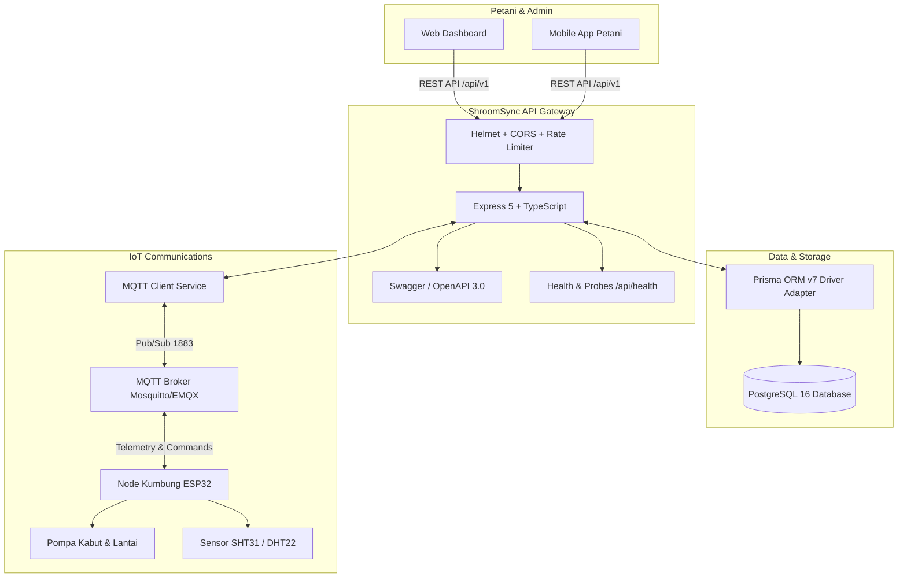

# 🍄 ShroomSync Backend API (Enterprise Edition)

[](https://www.typescriptlang.org/)
[](https://expressjs.com/)
[](https://www.prisma.io/)
[](https://www.postgresql.org/)
[](https://mqtt.org/)
[](https://www.docker.com/)
[]()

Backend service profesional dan berstandar industri untuk ekosistem **ShroomSync — Smart Cultivation Mushroom (SCM)**. Menghubungkan kumbung jamur berbasis mikrokontroler ESP32, web dashboard, dan aplikasi petani dengan latensi rendah, keamanan tinggi, dan pelacakan hasil panen yang presisi.

---

## 🏛️ Arsitektur Sistem



---

## ✨ Fitur Utama

- 🔐 **Multi-Role RBAC**: Hak akses berjenjang untuk `FARMER`, `TECHNICIAN`, dan `ADMIN`.
- 🌿 **Onboarding Petani**: Aktivasi kumbung mandiri via scan QR/Barcode fisik alat ESP32.
- ⚡ **Kontrol Aktuator Cerdas**: 3 Mode operasi (*Manual*, *Otomatis berbasis Suhu/Kelembaban*, dan *Jadwal Terprogram*).
- 💧 **Perlindungan Perangkat Keras**: Rate limiter khusus untuk aktuator guna mencegah *relay chattering* dan stres dinamo pompa.
- 📊 **Manajemen Siklus & Panen**: Kalkulasi otomatis umur siklus, produktivitas per baglog, rata-rata harian, pendapatan omset, dan deteksi panen puncak (*peak harvest day*).
- 🍄 **Preset Varietas Budidaya**: Rekomendasi otomatis setpoint agronomi untuk Jamur Tiram Putih, Tiram Cokelat, Kuping, Shiitake, Merang, dan Kancing.
- 🩺 **Deep Health Checks**: Endpoint `/api/health` memeriksa koneksi live database PostgreSQL (`SELECT 1`), broker MQTT, serta profil memori.
- 📖 **Dokumentasi Interaktif**: Swagger UI OpenAPI 3.0 terintegrasi di `/api/docs`.
- 🛡️ **Production-Hardened**: Zod environment fail-fast validation, structured JSON logging di production, dan graceful shutdown (SIGINT/SIGTERM).

---

## 🚀 Panduan Memulai Cepat (Quick Start)

### 1. Menjalankan dengan Docker Compose (Rekomendasi)

Hanya dengan satu perintah, seluruh stack (**PostgreSQL**, **Mosquitto MQTT**, dan **ShroomSync API**) akan otomatis menyala:

```bash
docker compose up -d
```

- API Server: `http://localhost:3000`
- Swagger UI: `http://localhost:3000/api/docs`
- Health Check: `http://localhost:3000/api/health`
- MQTT Broker: `localhost:1883`

---

### 2. Menjalankan Secara Lokal (Local Development)

#### Prasyarat
- Node.js >= 20.0.0
- PostgreSQL database berjalan lokal

#### Langkah Instalasi:

1. **Salin Environment Variables**:
   ```bash
   cp .env.example .env
   ```
   *Sesuaikan `DATABASE_URL` dengan kredensial PostgreSQL Anda.*

2. **Instal Dependensi**:
   ```bash
   npm install
   ```

3. **Generate Prisma Client & Migrasi Database**:
   ```bash
   npx prisma generate
   npm run prisma:migrate
   ```

4. **Isi Data Awal (Database Seeding)**:
   ```bash
   npm run prisma:seed
   ```
   *Perintah ini akan membuat akun demo:*
   - **Teknisi**: `tech@shroomsync.id` / `Password123!` (HP: `08111111111`)
   - **Admin**: `admin@shroomsync.id` / `Password123!` (HP: `08222222222`)
   - **Petani**: `farmer@shroomsync.id` / `Password123!` (HP: `08333333333`)
   - **Perangkat**: `SS-0426-001` (Kumbung Barat - Tiram Putih)

5. **Jalankan Development Server**:
   ```bash
   npm run dev
   ```

---

## 🧪 Menjalankan Automated Unit Tests

Proyek ini dilengkapi dengan unit test otomatis berbasis Node 20 test runner untuk memverifikasi logika bisnis inti:

```bash
npm test
```

Cakupan pengujian meliputi:
- Rentang agronomi & validitas preset jamur.
- Rumus kalkulasi matematika hasil panen & yield per baglog.
- Pembuatan, verifikasi, dan perlindungan pemalsuan token JWT.

---

## 📚 Dokumentasi Endpoint API

Buka browser Anda ke:
👉 **[http://localhost:3000/api/docs](http://localhost:3000/api/docs)**

| Kategori | Method | Endpoint | Deskripsi |
|---|---|---|---|
| **Health** | `GET` | `/api/health` | Status kesehatan sistem, DB probe, dan MQTT probe |
| **Auth** | `POST` | `/api/v1/auth/login` | Login Petani, Admin, atau Teknisi |
| **Auth** | `POST` | `/api/v1/auth/complete-onboarding` | Melengkapi profil petani & ganti password default |
| **Auth** | `GET` | `/api/v1/auth/me` | Profil pengguna terautentikasi |
| **Devices** | `GET` | `/api/v1/devices` | Daftar perangkat kumbung milik petani |
| **Devices** | `POST` | `/api/v1/devices/activate` | Aktivasi / hubungkan alat baru via ID / Scan QR |
| **Devices** | `POST` | `/api/v1/devices/unpair/:deviceId` | Lepaskan tautan perangkat kumbung |
| **Control** | `POST` | `/api/v1/devices/:deviceId/control/mode` | Ubah mode (Manual/Auto/Schedule) |
| **Control** | `POST` | `/api/v1/devices/:deviceId/setpoint` | Atur ambang suhu & kelembaban otomatis |
| **Control** | `POST` | `/api/v1/devices/:deviceId/timer` | Atur durasi timer penyemprotan pompa |
| **Control** | `POST` | `/api/v1/devices/:deviceId/actuator/pump` | Manual override on/off saklar pompa |
| **Control** | `POST` | `/api/v1/devices/:deviceId/actuator/fan` | Manual override on/off saklar kipas |
| **Telemetry** | `GET` | `/api/v1/devices/:deviceId/telemetry/sensor` | Riwayat pembacaan sensor dengan filter waktu |
| **Telemetry** | `GET` | `/api/v1/devices/:deviceId/telemetry/sensor/latest` | Data suhu & kelembaban real-time terkini |
| **Cycles** | `GET` | `/api/v1/devices/:deviceId/cycles` | Daftar siklus budidaya |
| **Cycles** | `POST` | `/api/v1/devices/:deviceId/cycles` | Memulai siklus budidaya baru |
| **Cycles** | `GET` | `/api/v1/devices/:deviceId/cycles/:cycleId/summary` | Resume statistik hasil panen & analisis performa |
| **Harvests** | `GET` | `/api/v1/devices/:deviceId/cycles/:cycleId/harvests` | Daftar riwayat catatan panen harian |
| **Harvests** | `POST` | `/api/v1/devices/:deviceId/cycles/:cycleId/harvests` | Catat bobot hasil panen baru |
| **Farmer** | `GET` | `/api/v1/farmer/dashboard` | Dashboard operasional terpadu petani |
| **Farmer** | `GET` | `/api/v1/farmer/presets` | Rekomendasi parameter varietas jamur |

---

## 📡 Komunikasi Protokol MQTT

Node mikrokontroler ESP32 berkomunikasi menggunakan broker MQTT dengan struktur topik standar:

- **Telemetry Sensor (ESP32 ➡️ Server)**: `{deviceId}/telemetry/sensor`
  ```json
  {"temperature": 25.4, "humidity": 88.2, "uptime": 3600000}
  ```
- **Heartbeat & Status (ESP32 ➡️ Server)**: `{deviceId}/telemetry/heartbeat`
  ```json
  {"rssi": -65, "firmware": "2.1.0"}
  ```
- **Instruksi Kontrol (Server ➡️ ESP32)**:
  - Mode Kontrol: `{deviceId}/cmd/mode`
  - Setpoint Ambang: `{deviceId}/cmd/setpoint`
  - Saklar Pompa/Kipas: `{deviceId}/cmd/actuator`

---

## 🏭 Production Build & Verification

```bash
# Build TypeScript ke JavaScript produksi (dist/)
npm run build

# Menjalankan build produksi
npm run prod
```

---

## 🛡️ Lisensi & Hak Cipta

Dikembangkan oleh **Tim ShroomSync (Smart Cultivation Mushroom)**. Hak Cipta Dilindungi Undang-Undang.

